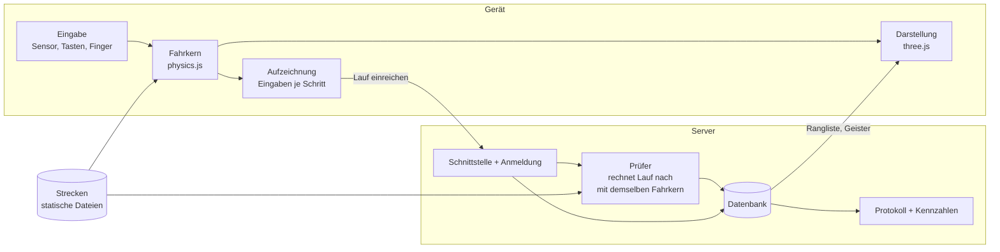

# Architektur Alpine Snowboard Racer (Zielbild)

Stand 2026-11-18. Gehört zu [produktskizze.md](produktskizze.md). Zielbild für Version 1; verbindlich ist vorerst nur
der Abschnitt „Jetzt festlegen“. Server-Technik (Kandidat PocketBase) wird nach dem Praxistest aus Abschnitt A
entschieden.

## Leitgedanken
1. **Ein Lauf ist die Folge der Eingaben.** Die Physik rechnet in festen Schritten (120 Hz) nur aus zwei
   Ganzzahlen je Schritt (Kante, Gewicht). Ein Lauf von 60 s sind rund 14 kB. Daraus folgen Geister,
   Ranglisten und die Prüfung von Zeiten.
2. **Der Server glaubt keiner Zeit.** Er rechnet jeden eingereichten Lauf nach und trägt die Zeit selbst ein.
3. **Spielen geht ohne Server.** Die Zeitjagd läuft vollständig im Gerät. Fällt der Server aus, fehlen nur
   Ranglisten und Gruppen.
4. **So wenig Personendaten wie möglich,** weil viele Spieler minderjährig sind.

## Stufen
| Stufe | Was man angibt | Was man bekommt | Server |
|---|---|---|---|
| **Gast** | nichts | Zeitjagd, eigener Geist, Bestzeit im Gerät | keiner |
| **Konto** | Name, dazu Anmeldung | Gruppenrunde, Parallel-Duell, Cup, Ranglisten, Bestzeiten auf jedem Gerät | ja |

Entschieden von Beo: Zeitjagd frei, alles andere mit Konto. Für ein Konto genügen **Name und Gerätekennung**;
die Mailadresse mit Login-Link ist freiwillig und nur für den Gerätewechsel nötig. Grund: Mit Pflicht-Mail
bräuchten unter 16-Jährige vorher die Einwilligung der Eltern, und eine Trainingsgruppe könnte auf dem Lehrgang
nicht spontan loslegen. Ohne Mail ist das Konto an das Gerät gebunden: Gerät weg oder Browserdaten gelöscht
heißt Konto weg.

## Bausteine

- **Fahrkern** (`physics.js`): ohne Bildschirm, ohne Uhr, ohne Zufall. Läuft unverändert im Browser, im
  Selbsttest und im Prüfer auf dem Server. Er ist das eigentliche Produkt; die Darstellung ist austauschbar.
- **Eingabe** (`input.js`): macht aus Sensor, Tasten oder Finger die zwei Werte. Einstellungen bleiben im Gerät.
- **Darstellung und Ablauf** (`main.js`): three.js, Menüs, Geister. Spielarten (Gruppenrunde, Duell, Cup) sind
  Abläufe um denselben Fahrkern, keine eigenen Physiken.
- **Strecken** (`tracks/*.json`): statische Dateien aus `psl-unreal`, hier nie von Hand geändert. Eine einmal
  veröffentlichte Strecke wird nicht überschrieben, sondern bekommt eine neue Kennung.
- **Server:** Anmeldung, Datenbank, Prüfer, Verwaltungsoberfläche. Kandidat PocketBase (eine Programmdatei mit
  SQLite, Anmeldung, Oberfläche, Live-Aktualisierung der Rangliste) auf einem kleinen Server in der EU.
  Der Prüfer läuft entweder in PocketBase selbst oder als kleiner Node-Dienst daneben; das entscheidet ein Versuch.
- **Auslieferung:** Die Seite bleibt statisch (kein Build-Schritt), zunächst GitHub Pages.

## Format eines Laufs
    { strecke: "ruhpolding_A2_spiel", streckenHash: "…", physik: 3, spur: 0,
      eingaben: <2 Bytes je Schritt, Base64>, zeitGemeldet: 41.27 }
- `physik` ist eine ganze Zahl, die bei **jeder** Änderung an `physics.js` oder an den Stellwerten `P` steigt.
- `streckenHash` ist die Prüfsumme der Streckendatei.
- Läufe gelten nur für genau diese Kombination. Ranglisten und Geister zeigen nur Läufe der aktuellen
  Kombination; ältere bleiben gespeichert, zählen aber nicht mehr.

## Daten auf dem Server
| Tabelle | Inhalt |
|---|---|
| `spieler` | Kennung, Anzeigename, Anmeldedaten; optional Mail, Verein, Team |
| `runden` | Code, Strecke, Spielart, Ersteller, Ablaufdatum |
| `teilnahmen` | Spieler in Runde |
| `laeufe` | Spieler, Runde (optional), Lauf wie oben, **geprüfte Zeit**, Zustand: eingereicht / gültig / abgelehnt |
| `duelle` | Runde, KO-Baum, Paarungen, Ergebnisse (verweist auf Läufe) |
| `cups`, `stationen`, `wertungen` | Cup, seine Strecken mit Termin, Punkte je Spieler |
| `protokoll` | wer, wann, was (siehe unten) |

Ranglisten sind Abfragen über `laeufe`, keine eigene Tabelle. Rollen: Spieler, Rundenleiter (Trainer, der eine
Runde eröffnet und darin Namen oder Läufe entfernen darf), Verwalter.

## Prüfung, Protokoll, Überwachung
- **Prüfung:** Der Server lädt Strecke und Physik in der genannten Version, spielt die Eingaben ab und
  vergleicht: im Ziel, kein Torfehler, Zeit. Erst dann ist der Lauf gültig. Zusätzlich Grenzen je Gerät und
  Stunde gegen Massen-Einreichungen.
- **Protokoll** (unveränderlich, nur anfügen): Konto angelegt/gelöscht, Anmeldung, Runde eröffnet/geschlossen,
  Lauf eingereicht mit Prüfergebnis, Lauf oder Name entfernt und von wem, Änderungen durch Verwalter, neue
  Physik- oder Streckenversion. Frist kurz halten (Vorschlag 90 Tage), danach nur Zählwerte.
- **Überwachung Gerät** (ohne Personenbezug): Sensorfreigabe erteilt/abgelehnt, Sensor-Rate, Bildrate,
  JavaScript-Fehler, Ausscheiden je Tor, Läufe je Sitzung.
- **Überwachung Server:** Erreichbarkeit von außen, Fehlerquote, Antwortzeit, Anteil abgelehnter Läufe,
  Füllstand, Alter der letzten Sicherung.
- **Sicherung:** Die SQLite-Datei täglich an einen zweiten Ort kopieren; Rückspielen einmal üben.

## Datenschutz von Anfang an
- Anzeigename frei wählbar, kein Klarname, kein Geburtsdatum. Ranglisten zunächst nur innerhalb einer Runde.
- Konto löschen entfernt Name und Anmeldedaten; Läufe bleiben ohne Namen oder werden mitgelöscht (zu entscheiden).
- Kein Tracking über Dritte, keine Werbekennungen. Server und Daten in der EU.
- Rechtsgrundlage und Einwilligung der Eltern: offen, mit dem Datenschutzbeauftragten des Verbands klären.

## Später, schon mitgedacht
- **Werbeflächen:** Banden und Flächen stehen als benannte Plätze in der Streckendatei; welches Motiv dort hängt,
  kommt aus einer Konfiguration. Erst Sponsoren der Veranstaltung als feste Bilder, ein Ad-Server kann später
  dieselben Plätze füllen. Logos nur vom Rechteinhaber.
- **Live-Duell:** Beide Geräte tauschen ihre Eingaben aus; wegen Leitgedanke 1 reicht das.
- **Native App:** neue Hülle um denselben Fahrkern, falls Safari bei Sensoren oder Bildrate nicht reicht.

## Risiken der Architektur
1. **Rechnen alle Geräte gleich?** Gemessen am 2026-11-18: `Math.sin`, `cos` und `atan2` liefern in Node 24 und
   Chrome 156 verschiedene letzte Stellen, derselbe Lauf lief schon auf dem Mac auseinander. Seit Physik 2
   nutzt der Fahrkern deshalb eigene Funktionen (`dsin`, `dcos`, `datan2`, `dhypot`), die nur aus
   Grundrechenarten und Wurzel bestehen; Node und Chrome zeigen seitdem dieselbe Prüfsumme.
   **Noch offen:** Safari auf dem iPhone und die Umgebung des Prüfers (PocketBase). Kontrolle: Die Seite zeigt
   unten links „Physik · Strecke · Prüfsumme“, `node selftest.mjs <dieselbe Strecke>` muss dasselbe ausgeben.
2. **Nachstellen der Physik entwertet Zeiten.** Gewollt (siehe Format), aber während der Abstimmung in
   Abschnitt A sind Ranglisten kurzlebig. Öffentliche Wertungen erst, wenn die Physik steht.
3. **PocketBase vor Version 1.0:** Updates können Umbauten erzwingen. Deshalb die Geschäftsregeln (Prüfer,
   Wertung) als eigenen, von PocketBase unabhängigen Code halten.
4. **Ein einzelner Server.** Für Lehrgänge und einen Cup genug; ein Ausfall trifft wegen Leitgedanke 3 nur
   die Vergleiche.

## Festgelegt in Abschnitt A (umgesetzt, noch ohne Server)
1. Physik-Versionsnummer (`VERSION` in `physics.js`) und Streckenprüfsumme stehen in jeder Aufzeichnung; der
   gespeicherte Geist wird verworfen, wenn eines nicht passt. `VERSION` steigt bei jeder Änderung an der
   Physik oder an `P`.
2. Fahrkern bleibt frei von Bildschirm, Uhr, Zufall und Fremdbibliotheken und ruft keine `Math`-Funktionen
   außer `sqrt`, `abs`, `min`, `max`, `sign`, `floor`, `round` auf.
3. Selbsttest und Seite geben dieselbe Prüfsumme aus (Endzustand des Autopiloten je Spur). Der Vergleich auf
   dem iPhone beantwortet den Rest von Risiko 1 beim Praxistest.

## Bis vor Abschnitt B entscheiden
PocketBase ja/nein und wo der Prüfer läuft; Betreiber und Standort des
Servers (Verband oder privat); Löschregeln und Aufbewahrungsfristen.
